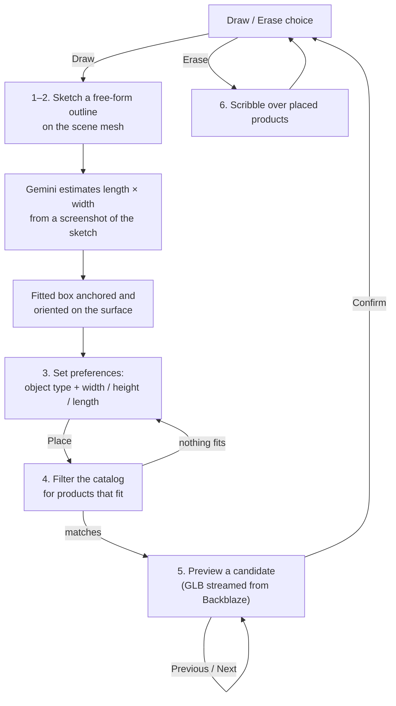

# PreviewAR

PreviewAR is an iOS augmented-reality app for trying out furniture in a real room by sketching where it should go. You draw a rough outline on the floor, and the app turns the sketch into a measured 3D box. Next you choose what kind of object you want and how much space it may take. The app finds catalog products that fit inside that box and places them in the room as life-size 3D models, which you can browse and keep. Erase mode removes anything you placed: scribble over it and it's gone.

**Stack:** Unity 6 (6000.0.58f2) · AR Foundation 6.4 + ARKit · Niantic Spatial SDK (NSDK) for scene meshing · Google Gemini for measuring sketches · glTFast for loading product models from Backblaze B2 · Modern UI Pack for the interface

## How it works



The interface has two modes, **Draw** and **Erase**, chosen from the bottom bar. Every placement or erase returns to that choice, so a room can be furnished one sketch at a time.

### 1. Scene mesh

Everything PreviewAR does in the room depends on a live 3D mesh of the space. The scene's `ARMeshManager`, extended by NSDK's `NsdkMeshingExtension`, fuses camera depth into a triangle mesh with 4 cm voxels. It uses LiDAR when the device has it, builds the mesh in 1.4 m blocks, and covers up to 10 m from the camera. Each block is spawned from [`Assets/MeshChunk.prefab`](Assets/MeshChunk.prefab), which carries a non-convex `MeshCollider`, so ordinary `Physics.Raycast` calls hit real floors, tables and walls.

Anchoring a sketch, orienting the box and seating products all use these raycasts. Surface normals within about 30° of vertical are snapped to exactly vertical, so small bumps in a scanned floor don't tilt the furniture. Slopes and walls keep their real normals.

### 2. Freeform sketching

When you tap **Draw**, the UI hides and [`LassoDrawer`](Assets/Scripts/LassoDrawer.cs) takes over input: touch on a device, mouse in the Editor. You drag out any shape on the floor (a loop, a rough rectangle, a scribbled footprint), and it shows as a green stroke. Touches that land on UI elements are ignored.

When you lift your finger:

1. **Capture.** The app finds the stroke's center on screen and takes a screenshot with the green sketch visible, scaled down to at most 768 px.
2. **Measure.** The screenshot goes to the Gemini `generateContent` API. The prompt asks for the real-world **length and width, in meters, of the best-fit rectangle** the sketch represents, returned as JSON (temperature 0.1). The scene uses `gemini-2.5-pro`. The stroke pulses while the request runs.
3. **Anchor.** A ray from the stroke's center hits the scene mesh, and that point becomes the bottom anchor of a box.
4. **Orient.** Points along the stroke are raycast onto the surface, and a 2D principal-component fit finds the sketch's main direction. The box's longer side is lined up with it. If too few points land on the surface, the box faces the camera's forward direction instead.
5. **Build.** A rounded green *fitted box* is created at Gemini's width × length, with a starting height of 5 cm.

If the Gemini call fails or its reply can't be parsed, the app uses a 0.5 m × 0.3 m box so you can carry on.

### 3. Spatial preferences

Next, [`BoxScaleUI`](Assets/Scripts/BoxScaleUI.cs) opens the resize panel, where you say *what* you want and *how much room* it may take:

- **Object type.** A dropdown of categories such as bed, chair, table, sofa and lamp, set on the component's `objectTypeDropdownOptions` list.
- **Width / Height / Length.** Sliders that start at Gemini's estimate and show inches. Gemini only measures the footprint, so **Height** is where you set the tallest object you'd accept.
- **VALID OPTIONS _N_.** A live count of catalog products that fit the current box.

Dragging a slider resizes the box in place, keeping its bottom on the surface. Each slider or dropdown change re-runs the catalog filter from step 4, so you can see right away whether a larger dimension or a different type would give more matches. Because the box starts 5 cm tall, the count stays at 0 until you raise Height.

### 4. Finding valid products

[`GLBSelector`](Assets/Scripts/GLBSelector.cs) loads the product catalog from `Assets/StreamingAssets/backblaze.json` at startup (format under [Getting started](#4-add-the-product-catalog)). A product is **valid** for the current box when all of these hold:

| Check | Rule |
| --- | --- |
| Status | `status` is `"ok"` |
| Type | `object_type` starts with the selected type (case-insensitive) |
| Size | `l ≤ box length`, `w ≤ box width` and `h ≤ box height`, in inches, with the product in its catalog orientation |

Pressing **Place** runs this filter and turns the result into a list of candidates. If nothing fits, the box stays on screen with the resize panel open, so you can change a dimension or the type and try again.

### 5. Placing products

When at least one product fits, the box pulses briefly while the first candidate loads:

1. The product's `.glb` is downloaded from the Backblaze B2 bucket at `https://<bucketName>.<endpoint>/<path>` and instantiated at runtime with glTFast. No product models are bundled with the app.
2. The model is turned to match the fitted box and scaled so its bounds match the catalog's real-world dimensions. It is then moved so the bottom of its bounds rests on the surface at the anchor point.
3. The fitted box disappears and the resize panel is replaced by **Previous**, **Next** and **Confirm** buttons. Previous and Next cycle the preview through every valid product.
4. **Confirm** keeps the current model in the room and gives it colliders. It is recorded as a placed object so it can be erased later. The app then goes back to the Draw / Erase choice for the next item.

### 6. Erasing

Tapping **Erase** turns the stroke red. When you lift your finger, each placed product's bounds are projected to a rectangle on screen, with 40 px of padding. Any product the stroke enters or crosses is deleted, and the app goes back to the Draw / Erase choice.

## Repository layout

| Path | Contents |
| --- | --- |
| [`Assets/Scenes/SampleScene.unity`](Assets/Scenes/SampleScene.unity) | The app's only scene: AR session, XR Origin with meshing, UI canvas, and the components below |
| [`Assets/Scripts/LassoDrawer.cs`](Assets/Scripts/LassoDrawer.cs) | Sketch input, the Gemini request, fitted-box placement and orientation, candidate search, GLB loading and placement, erasing |
| [`Assets/Scripts/BoxScaleUI.cs`](Assets/Scripts/BoxScaleUI.cs) | Draw / Erase switching, the resize panel (type dropdown and sliders), the valid-options counter, candidate buttons, runtime UI styling |
| [`Assets/Scripts/GLBSelector.cs`](Assets/Scripts/GLBSelector.cs) | Catalog loading, product filtering, Backblaze URL building |
| [`Assets/Scripts/RoundedSliderRuntimeFix.cs`](Assets/Scripts/RoundedSliderRuntimeFix.cs) | Cosmetic helper that reapplies rounded slider visuals at runtime |
| [`Assets/MeshChunk.prefab`](Assets/MeshChunk.prefab) | Template for each scene-mesh block (mesh, renderer, collider) |
| `Assets/images/` | Button icons: draw, erase, place, previous, next, confirm |
| `Assets/XR/` | XR loader and settings assets for ARKit, ARCore and NSDK |
| `Assets/Modern UI Pack/` | *Not in this repository.* Michsky's Modern UI Pack 5.5, a paid Unity Asset Store package used for buttons, sliders and the dropdown. See [Import Modern UI Pack](#2-import-modern-ui-pack) |
| `Assets/TextMesh Pro/` | TextMesh Pro essentials |
| `Assets/StreamingAssets/` | Location of the product catalog, `backblaze.json` |
| `Assets/Resources/Secrets/` | The local Gemini API key (gitignored) |
| [`Packages/manifest.json`](Packages/manifest.json) | Packages: NSDK (from GitHub; brings in AR Foundation, ARKit and ARCore), glTFast 6.18, Input System 1.14 |
| `ProjectSettings/` | Unity project settings (iOS 14+, NSDK + ARKit XR loader) |

## Getting started

### Requirements

- Unity **6000.0.58f2** with iOS Build Support
- Xcode and an ARKit-capable iPhone or iPad on iOS 14 or later (a LiDAR device gives the best scene mesh)
- [Modern UI Pack](https://assetstore.unity.com/packages/tools/gui/modern-ui-pack-201717) by Michsky, version 5.5, from the Unity Asset Store (paid)
- A Google Gemini API key
- A Niantic Spatial access token
- The product catalog, `backblaze.json`, and read access to its Backblaze B2 bucket

### 1. Open the project

Clone the repository and open the folder in Unity Hub. The first time it opens, Unity rebuilds `Library/` and downloads packages (including NSDK from GitHub), which takes several minutes.

### 2. Import Modern UI Pack

Modern UI Pack isn't in this repository, because its Asset Store license doesn't allow public redistribution. Until it's imported, `BoxScaleUI.cs` won't compile, since it uses the `Michsky.MUIP` namespace. If Unity offers to open in Safe Mode, choose **Ignore**.

Open **Window → Package Manager → My Assets**, find Modern UI Pack, and import it into its default folder, `Assets/Modern UI Pack/`. Do this before opening `SampleScene`. The project was built with version 5.5.27, and the scene's buttons, sliders and dropdown reconnect to the package once it's imported.

### 3. Add the Gemini API key

This repository doesn't store API keys. Create **`Assets/Resources/Secrets/GeminiApiKey.txt`** containing only your key. That folder is gitignored, and `LassoDrawer` loads the file when the scene starts. Without a key, every sketch falls back to the 0.5 m × 0.3 m default box. To change the model, set `geminiModel` on the `LassoDrawer` component.

### 4. Add the product catalog

Put the catalog at **`Assets/StreamingAssets/backblaze.json`**. The filename, bucket and endpoint are set on the `GLBSelector` component. It currently points at the `previewar` bucket on `s3.us-west-004.backblazeb2.com`.

```json
{
  "meshes": [
    {
      "path": "chairs/example_chair.glb",
      "object_type": "chair",
      "name": "Example Chair",
      "text_description": "Upholstered armchair",
      "standardized_dimensions": { "l": 30.0, "w": 28.0, "h": 34.0 },
      "status": "ok"
    }
  ]
}
```

| Field | Meaning |
| --- | --- |
| `path` | Object key of the `.glb` in the bucket. Downloaded over plain HTTPS from `https://<bucketName>.<endpoint>/<path>`, so it must be publicly readable |
| `object_type` | Category, matched against the dropdown selection by case-insensitive prefix |
| `name` | Name given to the spawned GameObject |
| `text_description` | Optional free text (the app doesn't use it yet) |
| `standardized_dimensions` | Real-world size in **inches**: `l` length, `w` width, `h` height |
| `status` | Only entries marked `"ok"` are used |

### 5. Authenticate the Niantic Spatial SDK

In **Project Settings → XR Plug-in Management**, open the Niantic Spatial settings and paste a token from the Niantic Spatial portal into **Niantic Spatial Access Token**. The token is saved in `Assets/XR/Settings/AuthBuildSettings.asset` and built into the app, so clear the field before you commit.

### 6. Build and run on iOS

1. Open **File → Build Profiles**, switch to **iOS**, and check that `Assets/Scenes/SampleScene.unity` is in the scene list.
2. Build into `Build/` (gitignored), open the generated Xcode project, choose your signing team, and run it on a device.

## Conventions

- **Units.** Unity works in meters. The catalog and the on-screen labels use inches (1 m = 39.3701 in).
- **Fitted-box axes.** `localScale.x` is width, `.y` is height and `.z` is length.
- **Anchoring.** The fitted box's bottom stays on the original surface hit point, so resizing never lifts it off the floor.
- **Debug images.** Each sketch saves `LassoCapture_Full.png` (the full screenshot) and `LassoCapture_GeminiInput.png` (exactly what Gemini received) to `Application.persistentDataPath`.

## Known limitations

- The Gemini prompt assumes a 1.6 m eye height and names scale cues from the original test site (concrete seams, an orange cone, benches). It needs retuning for other spaces.
- Gemini only estimates the footprint. Height always starts at 5 cm and is set by hand.
- Catalog matching compares axes in a fixed order. `allowRotationMatch` appears in the Inspector, and a rotation-aware helper (`FitsWithinAnyOrder`) exists, but `GetValidMeshes` uses neither yet.
- Placed furniture only lasts for the current session.
- The Gemini key ships inside the app's Resources, so anyone with a build can extract it. Before distributing the app beyond testing, send Gemini requests through a server instead.
